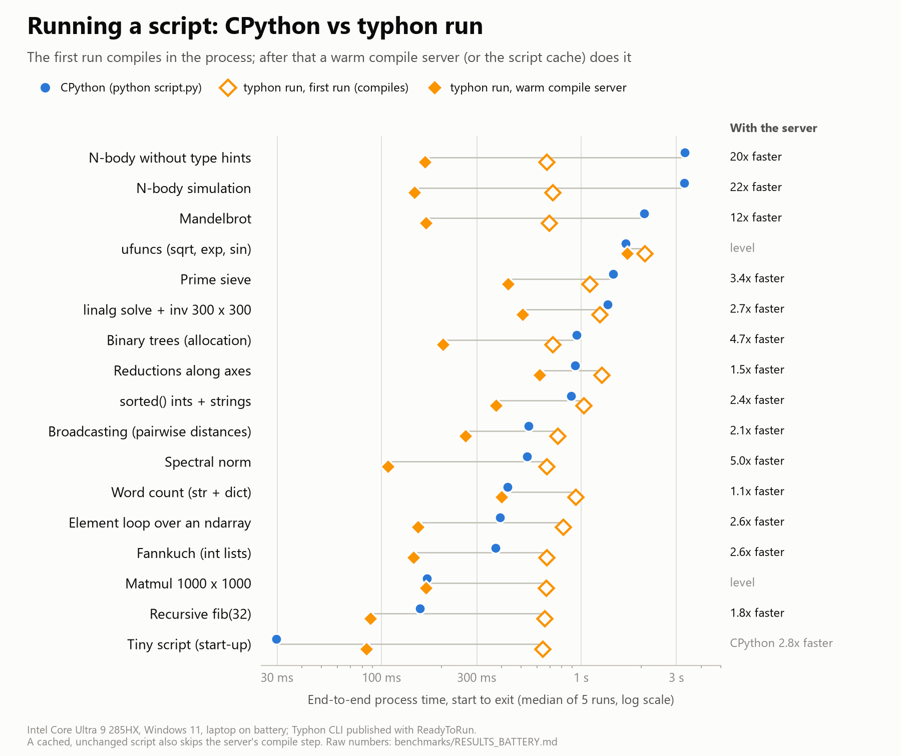
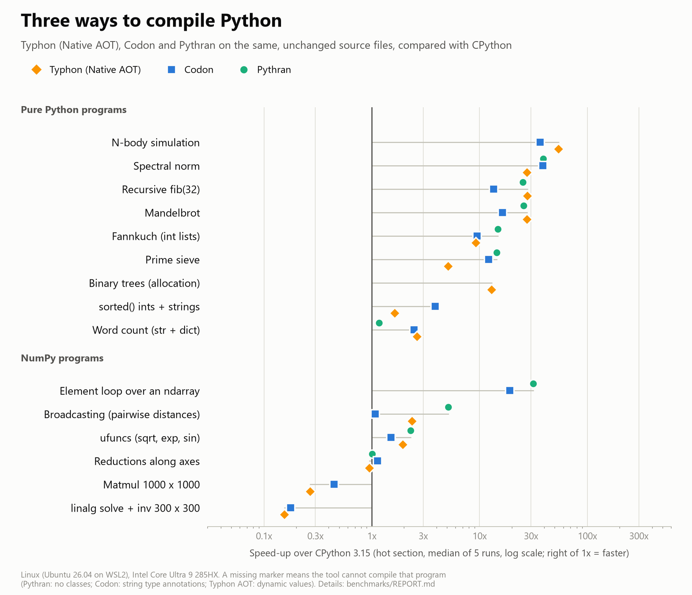

# Typhon — Python syntax, compiled to .NET IL

Typhon is a proof of concept for a **statically typed, Python-syntax language for .NET**. A `.ty` file is (in practice)
valid Python 3.12 source; the Typhon compiler turns it into ordinary IL, so Typhon code is a first-class .NET citizen:
C# can call it, subclass it and reference it like any other assembly, and Typhon can import any .NET namespace.

**The name:** Typhon comes from **ty**ped **Python** → **Ty**p**hon**. Type hints are what make it work: they let the
compiler produce fast, statically typed .NET code instead of interpreting Python's dynamic objects. The file extension
`.ty` follows from the same idea.

```python
from System.Text import StringBuilder          # import .NET like Python modules
from dataclasses import dataclass

@dataclass
class Point:                                    # → a real CLR class with typed properties
    x: float
    y: float

def total_length(points: list[Point]) -> float: # → static double total_length(List<Point> points)
    sb = StringBuilder()
    ...
```

It is **not** IronPython: IronPython keeps Python's dynamic semantics and therefore runs at roughly CPython speed.
Typhon requires/infers types and compiles to the same kind of IL C# produces, so tight loops run at C# speed.

## Project status: vibe-coded experiment

Typhon was fully "vibe-coded": an AI coding agent wrote the code as a proof of concept in a short amount of time, as part
of a raffle at the **Agentic Engineering Days 2026**. Its quality has not been measured or reviewed yet. Expect rough
edges, missing features and bugs, and no stability or support promises.

* **Model:** Claude Opus 5.5 (`claude-opus-5-5`) in Claude Code, including one sub-agent (same model) that wrote
  Typhon.NumPy; Claude Code used Claude Haiku 5.5 for small internal tasks.
* **Usage** (snapshot from Claude Code's usage screen about one hour into the session; the full session used more):
  Claude Opus 5.5 596.3k output tokens, 37.9M cached input tokens read, 729.5k cache-write tokens, 1.3k uncached
  input tokens; Claude Haiku 5.5 80.3k input / 5.0k output tokens. Estimated cost $24.47, 1 h 03 min wall-clock,
  11,061 lines added.

## Quick start (.NET 11 SDK)

```powershell
dotnet build Typhon.slnx                         # compiler, CLI, numpy library, samples

# 1. A pure Typhon console app — a normal .csproj whose sources are *.ty
dotnet run --project samples/HelloTyphon

# 2. A C# app using a Typhon class library *and* mixing .cs/.ty in one project
dotnet run --project samples/CSharpApp

# 3. Python-style scripting with the typhon CLI (published with ReadyToRun: compiles about twice as fast)
dotnet publish src/Typhon.Cli -c Release -r win-x64 -o tools/typhon    # linux-x64, osx-arm64, ...
tools/typhon/typhon run samples/scripts/tour.ty          # compile in memory and run, like `python tour.py`
tools/typhon/typhon emit samples/scripts/tour.ty         # show the generated C#
tools/typhon/typhon build samples/scripts/tour.ty -o out/tour            # → dotnet out/tour/typhon_tour.dll
tools/typhon/typhon build samples/scripts/tour.ty --aot -o out/tour-aot  # → native out/tour-aot/typhon_tour.exe
tools/typhon/typhon server status                        # the background compile server (see below)

# 4. Conformance tests: every case must print exactly what CPython prints
dotnet test tests/Typhon.Conformance.Tests

# 5. Benchmarks: the same files under CPython (+ NumPy) and Typhon, time and peak RAM
python -m venv .venv; .venv\Scripts\pip install numpy     # once, for the CPython side
./benchmarks/run.ps1
```

### Adding Typhon to any C# project

`.ty` files are compiled like `.cs` files — just put them in the project. In this repo the wiring lives in
`samples/Directory.Build.props`; for an external project it is one package reference (`dotnet pack src/Typhon.Compiler`):

```xml
<Project Sdk="Microsoft.NET.Sdk">
  <PropertyGroup>
    <TargetFramework>net11.0</TargetFramework>
    <TyphonTypeMode>strict</TyphonTypeMode>   <!-- strict | warn (default) | permissive -->
  </PropertyGroup>
  <ItemGroup>
    <PackageReference Include="Typhon" Version="0.1.0" PrivateAssets="all" />
  </ItemGroup>
</Project>
```

`**/*.ty` is included automatically (set `EnableDefaultTyphonItems=false` and add `<TyphonCompile Include="..." />`
items to control it yourself). Nothing in the .NET SDK, MSBuild or Roslyn is modified.

## How it works

```
 .ty ──► Lexer (INDENT/DEDENT) ──► Parser ──► AST ──► scope analysis ──► C# + #line ──► Roslyn ──► IL (.dll/.exe)
                                                         + type resolution          ▲
                                                           (Roslyn symbols)         │ same compilation as the
                                                                                    │ project's own .cs files
```

* **Front end** (`src/Typhon.Compiler/Syntax`): a hand-written tokenizer and recursive-descent parser for the Python
  subset. No dependency on CPython.
* **Lowering** (`src/Typhon.Compiler/Emit`): Typhon → C#. The interesting parts:
  * *Python has no `new`.* `Foo(1)` is a call or a construction depending on what `Foo` is, so the compiler resolves
    names against Typhon modules **and** the Roslyn compilation (referenced assemblies + C# code in the same project).
  * *Python locals are function-scoped, C# locals are block-scoped.* `LocalsAnalyzer` computes, per variable, the
    lowest common block of all uses; variables are declared inline with `var` (so C# infers the type) where possible,
    split into independent variables where their uses don't interact, and hoisted otherwise.
  * Python protocol methods (`__add__`, `__eq__`, `__str__`, `__getitem__`, `__iter__`, `__len__`, ...) are kept and
    bridged to .NET operators, `Equals`, `ToString`, indexers and `IEnumerable<T>`.
* **Back end = Roslyn.** The generated C# is compiled by Roslyn, which gives us overload resolution, generic inference,
  lambdas, async state machines, iterators, closures, PDBs and IL emission for free. `#line` directives map every
  error, warning, stack-trace line and breakpoint back to the `.ty` file.
* **Build integration** (`src/Typhon.Compiler/Generator`): an incremental Roslyn **source generator** receives the
  `.ty` files as `AdditionalFiles`. That is why Typhon and C# can live in one project and reference each other in
  both directions, and why Typhon types show up in C# IntelliSense.
* **Runtime** (`src/Typhon.Compiler/Runtime/Builtins.cs`): Python builtins (`print`, `len`, `range`, `sorted`, `format`,
  str/list/dict methods, ...) and small stdlib shims (`math`, `time`, `random`, `sys`, `os`, `asyncio`), compiled
  *into* every Typhon assembly as internal types — no runtime dependency. Scripts compiled in memory by `typhon run`
  reference a precompiled copy instead (`src/Typhon.Runtime`), which saves recompiling it on every run.
* **CLI** (`src/Typhon.Cli`): `typhon run` takes the fastest way that is still exact. An unchanged script that ran
  before comes from the **script cache** (like CPython's `__pycache__`, in the user's cache directory; a changed source
  file, imported module or compiler build invalidates and overwrites the entry; unused entries go after 30 days).
  Otherwise a background **compile server** with a warm compiler compiles it (like Roslyn's VBCSCompiler; one per user
  and CLI build, reachable only by that user, exits after 10 idle minutes). The very first run compiles in the
  process and starts the server. Switch them off with `TYPHON_CACHE=0` / `--no-cache` and `TYPHON_SERVER=0` /
  `--no-server`; `--time` shows which path was taken and how long it took.
* **numpy** (`src/Typhon.NumPy`): a numpy-compatible API (float64 `ndarray`, ufuncs, `@`, `linalg`, `random`) written
  in C# on top of `System.Numerics.Tensors.TensorPrimitives` (SIMD).

## The language

### Types: gradual, TypeScript-style

| Python annotation | C# / CLR type | | Python annotation | C# / CLR type |
|---|---|---|---|---|
| `int` | `int` (System.Int32) | | `list[T]` | `List<T>` |
| `float` | `double` | | `dict[K, V]` | `Dictionary<K, V>` |
| `str` | `string` | | `set[T]` | `HashSet<T>` |
| `bool` | `bool` | | `tuple[A, B]` | `(A, B)` (ValueTuple) |
| `None` (return) | `void` | | `Optional[T]`, `T \| None` | `T?` |
| `Any` | `dynamic` | | `Callable[[A], R]` | `Func<A, R>` / `Action<A>` |
| `Iterator[T]` | `IEnumerable<T>` | | `Array[T]` (Typhon) | `T[]` |
| `decimal`, `long`, `float32`, ... | `decimal`, `long`, `float`, ... | | any .NET type | itself |

Locals are inferred (`x = 1.5` → `var x = 1.5`). Parameters, return types and fields without annotations are inferred
from the whole program:

* **Parameters from call sites.** Every call of a project function or constructor records the argument types. Each
  distinct combination becomes one typed overload, so `scale(3)` and `scale(1.5)` call `scale(int)` and
  `scale(double)` and keep Python's int/float behaviour.
* **Return types from `return` statements**, including recursion (`fib(n)` → `int`) and `None` (a function that
  returns an `int` or `None` → `int?`).
* **Fields from the constructor**: `self.x = x` gets the type `x` has in every constructor signature.

The untyped (`dynamic`) version of a function stays only where it can actually run: when a call passes a value of
unknown type. A function passed as a value (`map(f, xs)`) is called through a lambda and keeps it too. The inference
runs the emitter until the signatures stop changing; if they do not settle, the code is emitted as written.
[`tests/conformance/cases/untyped.ty`](tests/conformance/cases/untyped.ty) has no annotations at all and compiles
with `--strict`. Not inferred yet: parameters of methods other than `__init__`. Note that a public function called only
with ints inside the project gets an `int` signature for C# callers too.

Where the compiler still cannot determine a type — an empty `[]`, a value from a dynamic API, a function that is only
called from C# — it falls back to C# `dynamic`, and `TyphonTypeMode` decides what that means:

| Mode | Implicit `dynamic` | Use for |
|---|---|---|
| `strict` | compile error (TY1001) | libraries, hot paths, a prerequisite for Native AOT |
| `warn` (default) | compiles, warning per site | normal code, gradual migration |
| `permissive` | compiles silently | porting existing Python |

An explicit `Any` annotation is always allowed. The cost is real: `benchmarks/bench_nbody.ty` and its
annotation-free twin `bench_nbody_untyped.ty` differ by 46x (see below).

### Semantics: Python syntax, CLR types, Python-flavoured operators

Typhon deliberately uses **CLR semantics for types and objects** (fixed class layouts, nominal types, 32-bit `int`,
reference equality unless `__eq__` is defined) and **Python semantics where it is cheap and expected**:

* `/` is true division, `//` floor division, `%` takes the sign of the divisor, `**` is power
* truthiness in conditions (`if items:`), `and`/`or`/`not`, chained comparisons, `in`/`not in`, `is None`
* slicing with clamping, negative indices and steps (`s[::-1]`), `[0] * n`, `"-" * 40`, `list + list`
* `print`/`str`/`repr`/f-strings format like CPython (`True`, `None`, `[1, 2]`, `{'a': 1}`, `1.0`, `Color.RED`)
* Python exceptions map to .NET ones (`ValueError` → `ArgumentException`/`FormatException`, `KeyError` →
  `KeyNotFoundException`, ...), so `except ValueError` catches what .NET throws and C# can catch what Typhon raises

### Supported (PoC)

Modules & packages (folders → namespaces), `import`/`from ... import` of Typhon modules, .NET namespaces/types and the
Typhon stdlib, functions with defaults/`*args`/keyword arguments, PEP 695 generics (`def f[T]`, `class Box[T]`, bounds),
classes with inheritance, `super()`, properties (+setters), `@staticmethod`/`@classmethod`, `@abstractmethod`/`ABC`,
`@override`, `@final`, `@dataclass`, `Enum`, `Protocol` (→ interface, implemented structurally *or* explicitly),
operator overloading, any other decorator → .NET attribute (`@Obsolete("...")`, `@Fact`), docstrings → XML docs,
`if/elif/else`, `while`, `for` (counting loops over `range` compile to plain `for` loops; iterating a dict yields its
keys), `del d[key]`/`del xs[i]`, `try/except/else/finally`,
`raise`, `with` (→ `using`), `async def`/`await`/`async for`/`async with` (→ `Task`), generators (`yield`, `yield from`),
lambdas, closures, `global`/`nonlocal`, list/dict/set comprehensions and generator expressions (→ LINQ), f-strings with
the Python format-spec mini-language, tuple unpacking, `if __name__ == "__main__":` (or a `__main__.ty` file) as the
entry point, `asyncio.run(...)` to call async code from synchronous code.

### Not supported yet / known gaps

`match`, walrus `:=`, `**kwargs`, `del` of names/attributes/slices, `while/for ... else`, bytes, complex, `%`-formatting, metaclasses,
`eval`/`exec`/`setattr` and other runtime reflection on Python objects, multiple inheritance of classes, tuple indexing
(`t[0]`; use unpacking), static methods on generic classes need explicit type arguments (`Stack[int].of(...)`),
.NET `out`/`ref` parameters (planned: tuple returns like IronPython), arbitrary-precision `int` (`int` is 32-bit),
iterating a `str` yields `char` (which has the common str methods), a dict that had keys deleted puts new keys into the
freed slots instead of at the end (it is a .NET `Dictionary`). Union types other than `X | None` are `object` for now
(see roadmap). The conformance suite below tracks the differences that are known.

**numpy (Typhon.NumPy)** covers the common API (creation, ufuncs with broadcasting, reductions with `axis`, `@`,
`linalg`, `random`, slicing/masks) but: float64 only, slices and `.T` are copies (`reshape`/`ravel` are views),
`a[i]` returns `dynamic` (annotate the target, `v: float = a[i]`, to get back to static code), `==` compares references
(use `np.equal`), random streams are deterministic per seed but differ from NumPy's.

## Conformance tests

CPython is the oracle. `tests/conformance/cases/*.ty` are small programs that cover one area each: arithmetic, strings and
format specs, collections, dict semantics, control flow and exceptions, functions and generators, classes and dunder
methods, printing, async, NumPy. They are valid Python. `tests/conformance/expected/*.out` holds what CPython 3.15 printed
for them, and a case passes only when Typhon's output matches it byte for byte.

```powershell
dotnet test tests/Typhon.Conformance.Tests                                   # typhon run (JIT) vs expected output
$env:TYPHON_CONFORMANCE_AOT = "1"; dotnet test tests/Typhon.Conformance.Tests   # also build every case with --aot
python tests/conformance/update_expected.py                                  # regenerate expected/*.out after changing a case
```

* The suite also re-runs every case under CPython (`TYPHON_CPYTHON`, the repo's `.venv`, or `python` on PATH), so a
  stale `.out` file fails the build.
* Known differences are listed in [`tests/conformance/known-failures.txt`](tests/conformance/known-failures.txt) with
  the reason. Such a case must keep failing: when a fix makes it pass, the suite fails until the line is removed.
* CI ([`.github/workflows/ci.yml`](.github/workflows/ci.yml)) runs the suite on Windows and Linux. The Native AOT pass
  can be started by hand.

Status: 10 of 12 cases match CPython under `typhon run`. With `--aot`, 8 of them build and match as native executables
(`arithmetic` and `numpy_basics` use dynamic values, which Native AOT rejects). Known failures: dict insertion order after deleting keys, and NumPy details
(`a.shape` is not a tuple, stepped `ndarray` slices, boolean `sum`). Writing the suite surfaced and fixed these
differences: inherited constructors (an `Exception` subclass without `__init__`), `sorted()` over objects with
`__lt__`, `Color.RED.value`/`.name`, `type(x).__name__`, `try/except/else` in functions that return a value,
`except ValueError` catching an `IndexError`, iterating a dict, `d.get(k)` without a default, `del`, the `g` format and
float repr (`1e+16`), and built-in functions as values (`map(str, xs)`, `key=len`). The Native AOT pass found two more:
`len()` of a class with `__len__` and the repr of a `set` relied on reflection that AOT trims away.

## Benchmark results

Every benchmark is a single file that is valid Python *and* valid Typhon. CPython 3.15.2 runs it directly, Typhon
compiles it (JIT or Native AOT); the runners check that every tool prints the same result (they all do) and report the
median of 5 runs plus the peak RAM of each process. Full analysis, method and caveats:
**[benchmarks/REPORT.md](benchmarks/REPORT.md)**; raw tables: [RESULTS.md](benchmarks/RESULTS.md) (Windows, plugged
in), [RESULTS_BATTERY.md](benchmarks/RESULTS_BATTERY.md) (Windows, on battery, with compile times and type inference)
and [RESULTS_LINUX.md](benchmarks/RESULTS_LINUX.md) (Linux, incl. Codon and Pythran). Measured on an Intel Core Ultra 9
285HX laptop, .NET 11.0.100, CPython 3.15.2, NumPy 2.5.5 + OpenBLAS.


* **Typed pure-Python programs: 1.9–75x faster** than CPython; geometric mean **11.1x with the JIT, 13.6x as a Native
  AOT executable** (9 programs). Largest on numeric code over floats and small objects, smallest on `str`/`dict`/sorting,
  where CPython already runs C.
* **Types are the reason, and they no longer have to be written.** Without annotations the N-body source used to fall
  back to `dynamic` (1.5x faster than CPython). Whole-program inference now types it completely: it runs as fast as the
  annotated version (74x vs 72x in the same run) and builds as a Native AOT executable.
* **Running a script costs little extra.** `typhon run` compiles on the first run (0.65–0.8 s for most programs);
  after that a warm compile server or the script cache take over, and a tiny script runs in about 80 ms (CPython
  30 ms). Apart from such tiny scripts, every pure-Python benchmark already runs faster than on CPython that way, compile
  included
  ([details](#one-off-scripts-compile-time-included)).
* **Native AOT**: one self-contained 1.5–1.9 MB executable, **9 MB of RAM** for small programs (CPython 12 MB, JIT 20 MB);
  on Linux a tiny program starts in **1.8 ms with 4 MB**, the fastest and leanest of every tool tested.
* **NumPy programs: rough parity** (geometric mean 1.04x JIT, 1.13x AOT, each side in its faster thread setting).
  Typhon.NumPy wins element loops and broadcasting; NumPy wins matrix multiply and dense linear algebra (BLAS/LAPACK).

### Pure Python programs (Windows)

| Program | CPython | Typhon JIT | Typhon AOT | Speed-up JIT | Speed-up AOT | RAM CPython | RAM JIT | RAM AOT |
|---|---|---|---|---|---|---|---|---|
| N-body | 3,024 ms | 40.3 ms | 43.8 ms | **75x** | **69x** | 12 MB | 21 MB | 9 MB |
| Spectral norm | 469 ms | 9.7 ms | 8.6 ms | **48x** | **54x** | 12 MB | 21 MB | 9 MB |
| Mandelbrot | 2,067 ms | 51.1 ms | 51.9 ms | **40x** | **40x** | 12 MB | 20 MB | 9 MB |
| fib(32) | 134 ms | 9.0 ms | 4.7 ms | **15x** | **29x** | 12 MB | 20 MB | 9 MB |
| Binary trees | 783 ms | 75.3 ms | 55.5 ms | **10x** | **14x** | 22 MB | 43 MB | 32 MB |
| Fannkuch | 324 ms | 39.1 ms | 28.4 ms | **8.3x** | **11x** | 12 MB | 41 MB | 27 MB |
| Prime sieve | 989 ms | 358 ms | 199 ms | **2.8x** | **5.0x** | 50 MB | 37 MB | 23 MB |
| Word count (str + dict) | 413 ms | 161 ms | 140 ms | **2.6x** | **3.0x** | 12 MB | 41 MB | 27 MB |
| `sorted()` ints + strings | 353 ms | 182 ms | 218 ms | **1.9x** | **1.6x** | 88 MB | 61 MB | 54 MB |

The N-body source without type hints is not in this table: this run predates type inference, when it was 1.5x faster than
CPython. With inference it runs as fast as the annotated version: 74x vs 72x in the battery run (see [On battery](#on-battery)).

### NumPy programs (Windows)

Typhon runs these against Typhon.NumPy, a numpy-compatible library in C# (NumPy itself is C/Fortran and is not
compiled). Each side in its faster thread setting.

| Program | NumPy | Typhon JIT | Typhon AOT | Speed-up (best Typhon) | RAM NumPy | RAM JIT | RAM AOT |
|---|---|---|---|---|---|---|---|
| Element loop `for i in range(n): a[i]` | 271 ms | 54.0 ms | n/a (dynamic) | **5.0x** | 43 MB | 61 MB | – |
| Broadcasting (pairwise distances) | 268 ms | 95.9 ms | 52.9 ms | **5.1x** | 211 MB | 516 MB | 578 MB |
| ufuncs (`sqrt`, `exp`, `sin`) | 1,184 ms | 1,089 ms | 522 ms | **2.3x** | 74 MB | 362 MB | 225 MB |
| Reductions along axes | 414 ms | 340 ms | 224 ms | **1.8x** | 89 MB | 91 MB | 72 MB |
| Matmul 1000 x 1000 | 17.4 ms | 24.4 ms | 40.3 ms | **NumPy 1.4x faster** | 64 MB | 89 MB | 56 MB |
| `linalg.solve` + `inv` 300 x 300 | 31.7 ms | 325 ms | 159 ms | **NumPy 5.0x faster** | 37 MB | 37 MB | 16 MB |

### Startup and footprint

A tiny program (`bench_startup.ty`), measured from start to exit:

| | Windows: time | Windows: RAM | Linux: time | Linux: RAM | What you ship |
|---|---|---|---|---|---|
| CPython | 19.7 ms | 12 MB | 9.2 ms | 12 MB | the `.py` file + a Python installation |
| Codon | – | – | 8.3 ms | 10 MB | a small executable + Codon's runtime libraries |
| Typhon JIT | 34.5 ms | 20 MB | 20.0 ms | 30 MB | a 0.05 MB `.dll` + the .NET runtime |
| **Typhon Native AOT** | **21.3 ms** | **9 MB** | **1.8 ms** | **4 MB** | **one 1.5–1.9 MB self-contained executable** |

### One-off scripts: compile time included

The tables above time programs that are already compiled. A Python script is often run just once, so this compares
the whole process from start to exit: `python script.py` and `typhon run script.ty` in its three situations, plus a
program built ahead of time. Measured on battery ([RESULTS_BATTERY.md](benchmarks/RESULTS_BATTERY.md)) with the CLI
published as ReadyToRun.

* **First run**: `typhon run` compiles in its own process (parse, type inference, Roslyn) and starts the compile server
  in the background.
* **Compile server**: later runs send the script to the warm server, which compiles it in about 20–110 ms.
* **Cached**: an unchanged script that ran before is not compiled at all (like CPython's `__pycache__`).



| Program | CPython | First run | Compile server | Cached | `typhon build` | Built, per run | Build pays off | `build --aot` | AOT, per run | AOT pays off |
|---|---|---|---|---|---|---|---|---|---|---|
| Tiny script (start-up) | 30 ms | 642 ms | 84 ms | 80 ms | 1,034 ms | 45 ms | never | 5,775 ms | 23 ms | after 831 runs |
| fib(32) | 155 ms | 654 ms | 88 ms | 83 ms | 1,026 ms | 72 ms | after 13 runs | 5,917 ms | 34 ms | after 49 runs |
| Spectral norm | 536 ms | 671 ms | 107 ms | 111 ms | 939 ms | 58 ms | after 2 runs | 5,887 ms | 41 ms | after 12 runs |
| Word count | 428 ms | 935 ms | 400 ms | 281 ms | 996 ms | 221 ms | after 5 runs | 6,736 ms | 228 ms | after 34 runs |
| Binary trees | 948 ms | 719 ms | 204 ms | 174 ms | 955 ms | 128 ms | after 2 runs | 6,610 ms | 99 ms | after 8 runs |
| Prime sieve | 1,449 ms | 1,102 ms | 431 ms | 431 ms | 923 ms | 425 ms | 1st run | 6,083 ms | 251 ms | after 6 runs |
| Mandelbrot | 2,063 ms | 691 ms | 167 ms | 147 ms | 954 ms | 116 ms | 1st run | 5,613 ms | 93 ms | after 3 runs |
| N-body | 3,283 ms | 721 ms | 146 ms | 126 ms | 915 ms | 95 ms | 1st run | 5,546 ms | 78 ms | after 2 runs |
| N-body without type hints | 3,301 ms | 670 ms | 165 ms | 114 ms | 947 ms | 103 ms | 1st run | 5,852 ms | 80 ms | after 2 runs |
| NumPy matmul | 169 ms | 667 ms | 167 ms | 140 ms | 1,128 ms | 121 ms | after 24 runs | 6,199 ms | 88 ms | after 77 runs |
| NumPy ufuncs | 1,666 ms | 2,080 ms | 1,703 ms | 1,632 ms | 952 ms | 1,525 ms | after 7 runs | 6,151 ms | 710 ms | after 7 runs |

* **First run**: 0.64–0.81 s for 11 of 17 programs, about 2.8x less than before the improvements below (1.8–2.1 s
  for the same programs). It already beats CPython on 6 programs (N-body 4.6x, Mandelbrot 3.0x).
* **While you work** (compile server or cache): within 6–180 ms of a program built ahead of time. CPython stays faster
  only for the tiny script (30 vs 84 ms) and is level on the two NumPy programs dominated by BLAS and ufunc kernels.
* **Building ahead** still gives the fastest process: `typhon build` takes about 1 s and pays off after 1–13 runs on
  pure-Python programs; Native AOT builds take 5.5–6.7 s.

What made `typhon run` faster (tiny script, battery):

| `typhon run` | Process time |
|---|---|
| Before: Roslyn JIT-compiled on every start, Typhon runtime compiled from source every time | 1,879 ms |
| + CLI published with ReadyToRun, runtime precompiled (`src/Typhon.Runtime`) | 642 ms |
| + warm compile server | 84 ms |
| + script cache (unchanged script) | 80 ms |

Where the time went before: a cold compile spent about 1.2 s in Roslyn, mostly Roslyn itself being JIT-compiled, and
most of a warm compile was the Typhon runtime's own source (about 180 ms of 200 ms). Typhon's parser, type inference
and C# emission take 6–30 ms once warm.

### On battery

The same benchmark on battery power ([RESULTS_BATTERY.md](benchmarks/RESULTS_BATTERY.md), Windows "Balanced" plan)
against the plugged-in run ([RESULTS.md](benchmarks/RESULTS.md)):

| | Plugged in | On battery |
|---|---|---|
| Typed programs, speed-up (geometric mean, JIT / AOT) | 11.1x / 13.6x | 10.7x / 12.6x |
| fib(32): CPython / Typhon JIT / Typhon AOT | 134 / 9.0 / 4.7 ms | 123 / 12.5 / 5.4 ms |
| N-body: CPython / Typhon JIT / Typhon AOT | 3,024 / 40.3 / 43.8 ms | 3,250 / 45.2 / 46.2 ms |
| Tiny script, whole process: CPython / Typhon JIT / Typhon AOT | 19.7 / 34.5 / 21.3 ms | 29.7 / 45.3 / 22.7 ms |
| `typhon build --aot` (median per program) | 4,767 ms | 6,098 ms |
| N-body without type hints: Typhon JIT (speed-up) | 2,168 ms (1.5x, before inference) | 44.0 ms (74x, with inference) |

* Hot loops on battery: CPython −9% to +42% (median +7%), Typhon JIT +5% to +39%, Typhon AOT +3% to +55%. Typhon's
  short, tight loops lose the most (fib), so the speed-ups shrink by 4–7% on average but keep their order.
* Process start gets 7–51% slower, Native AOT builds 28%. Battery runs vary: an earlier battery run measured process
  starts about twice as slow as plugged in.
* Every program printed the same result as CPython in both runs.

### Typhon vs Codon vs Pythran (Linux)

The same files compiled with two other Python compilers, [Codon](https://github.com/exaloop/codon) (whole programs to
native code via LLVM) and [Pythran](https://github.com/serge-sans-paille/pythran) (numeric functions to C++), on Linux
(WSL2, same machine), each compared with CPython on Linux:



Speed-up over CPython (Linux):

| Program | Codon | Pythran | Typhon JIT | Typhon AOT |
|---|---|---|---|---|
| N-body | 37x | n/a (classes) | **62x** | 54x |
| Spectral norm | 39x | 39x | **41x** | 28x |
| Mandelbrot | 16x | 26x | **28x** | **28x** |
| fib(32) | 14x | 25x | 14x | **28x** |
| Binary trees | n/a (string annotation) | n/a (classes) | 8.2x | **13x** |
| Fannkuch | 9.5x | **15x** | 6.6x | 9.3x |
| Prime sieve | 12x | **15x** | 2.8x | 5.1x |
| `sorted()` | **3.9x** | n/a (not in a function) | 2.0x | 1.6x |
| Word count | 2.5x | 1.2x | 1.9x | **2.6x** |
| N-body without type hints | **29x** | n/a (classes) | 1.1x (before inference) | n/a (dynamic) |
| NumPy element loop | 19x | **31x** | 4.4x | n/a (dynamic) |
| NumPy broadcasting | 1.1x | **5.1x** | 1.4x | 2.4x |
| NumPy ufuncs | 1.5x | **2.3x** | 0.8x | 1.9x |
| NumPy matmul 1000 x 1000 | 0.4x | n/a (not in a function) | **0.6x** | 0.3x |

On the 6 programs all of them can compile: **Pythran 13.6x, Typhon AOT 11.8x, Codon 11.6x, Typhon JIT 9.2x** (geometric
means). Typhon leads on float- and object-heavy code, Codon and Pythran on integer/list code and NumPy-style code. In this
run only Codon stayed fast without type hints, because it infers types for the whole program; Typhon does that now too
(74x on Windows, see [On battery](#on-battery)), the Linux run predates it.

Peak RAM (Linux, max resident set size):

| Program | CPython | Codon | Pythran | Typhon JIT | Typhon AOT |
|---|---|---|---|---|---|
| Startup (tiny program) | 12 MB | 10 MB | n/a | 30 MB | **4 MB** |
| fib, Mandelbrot, N-body, spectral norm | 12 MB | 10 MB | 29–30 MB | 29–30 MB | **4 MB** |
| Fannkuch | 12 MB | **10 MB** | 29 MB | 50 MB | 22 MB |
| Word count | 12 MB | **11 MB** | 29 MB | 51 MB | 23 MB |
| Prime sieve | 50 MB | **15 MB** | 30 MB | 46 MB | 19 MB |
| `sorted()` | 87 MB | 53 MB | n/a | 71 MB | **49 MB** |
| NumPy broadcasting | 214 MB | 165 MB | **30 MB** | 522 MB | 462 MB |
| NumPy ufuncs | 76 MB | 96 MB | **37 MB** | 365 MB | 104 MB |

Typhon AOT is the leanest for compute-heavy code; Codon stays lean in allocation-heavy code too (Typhon's garbage
collector frees memory in batches); Pythran has a ~29 MB floor (every Pythran module imports NumPy) but is by far the
leanest on NumPy code, because its C++ expression templates fuse whole expressions into one loop without temporary
arrays.

**Platforms.** Typhon's JIT build is a single IL `.dll` that runs unchanged on every OS and CPU with a .NET runtime
(tested here on Windows and Linux); its Native AOT build is a native executable per target OS. Codon has no Windows
support (Linux and macOS) and its executables need Codon's runtime libraries. Pythran builds a C++ extension module per
OS *and* Python version and always needs CPython to run (on Windows it needs a C++ compiler such as clang-cl).

### Do you still need NumPy?

The same problem written as plain Python loops and as vectorized NumPy code, each run on both runtimes (Windows):


| Problem | CPython loops | CPython + NumPy | Typhon loops (JIT) | Typhon loops (AOT) | Typhon + NumPy (AOT) |
|---|---|---|---|---|---|
| Mandelbrot 400 x 400 | 496 ms | 415 ms | 14.2 ms | **11.4 ms** | 234 ms |
| Pairwise distances, 1500 points | 148 ms | 30.3 ms | 3.9 ms | **3.3 ms** | 8.1 ms |
| Estimate π, 5M points | 388 ms | 160 ms | 45.0 ms | 43.5 ms | **32.9 ms** |
| Moving average, 5M samples | 329 ms | **31.3 ms** | 56.0 ms | 56.3 ms | n/a (dynamic) |
| Dot product, 10M floats | 152 ms | **1.4 ms** | 6.8 ms | 6.5 ms | n/a (dynamic) |
| Matrix multiply 200 x 200 | 206 ms | **0.4 ms** | 12.3 ms | 7.4 ms | 0.7 ms |

Plain loops in Typhon are 6–38x faster than plain loops in CPython and beat vectorized NumPy on 3 of 6 problems, where
vectorizing forces extra work (Mandelbrot can't exit early per point; pairwise distances and π build large temporary
arrays). NumPy stays ahead where one tuned kernel does the whole job (BLAS for dot product and matmul).

**RAM.** With the JIT, Typhon starts ~8 MB higher (the .NET runtime) and its garbage collector frees memory in batches
rather than immediately, so small and allocation-heavy programs use more RAM. Native AOT removes the runtime floor
(9 MB vs CPython's 12 MB). Typed lists are far denser than Python lists, so programs holding big lists use 2.7–2.9x
*less* (dot product 175 vs 468 MB). Large NumPy temporaries are the weak spot (up to 5x NumPy's peak);
[the report](benchmarks/REPORT.md#6-why-typhon-sometimes-uses-more-ram) breaks this down.

**Not measured:** PyPy, Cython, mypyc, Numba, CPython's experimental JIT. Compile time is excluded (median per program:
Typhon 1.3 s, Typhon AOT 4.8 s, Codon 4.3 s, Pythran 1.6 s); a compiled Typhon program is still faster end-to-end than
CPython on every pure-Python benchmark.

## Design notes and important decisions

1. **Transpile through C# instead of emitting IL directly.** Emitting IL ourselves would mean re-implementing C#'s
   overload resolution, generic inference, lambdas/closures, async and iterator state machines, `dynamic` call sites,
   and PDB generation. Going through Roslyn gives all of that, guarantees "fully compatible with C#" by construction,
   and still produces plain IL. The front end is backend-agnostic, so a direct IL backend remains possible.
2. **Source generator, not a separate compiler.** It plugs into every C# project without touching the SDK, works in
   the IDE, and lets C# and Typhon reference each other inside one assembly. The price: a pure Typhon project is still a
   `.csproj`, and generators run on every IDE keystroke (they need to stay fast). A dedicated MSBuild SDK
   (`<Project Sdk="Typhon.Sdk">`) can come later.
3. **Static by default, dynamic as an explicit escape hatch.** Speed and C# interop both come from static types;
   gradual typing keeps porting possible. `typhon build --aot` builds a native executable; it additionally rejects dynamic values that come from libraries (TY2001), because Native AOT cannot run late-bound code.
4. **"Valid Python" as a design constraint.** Never add syntax CPython can't parse. You get editor support, formatters
   and linters for free, and — as the benchmarks show — the same file can run on both runtimes, which is also the
   cheapest possible conformance test: diff the outputs (that is exactly what `tests/conformance` does).
5. **Names are kept as written** (`calculate_area` stays `calculate_area` for C# callers). Leading `_` → `internal`
   / `protected internal`, `__x` → `private`. A PascalCase-mapping option is easy to add if C# consumers want it.
6. **Python protocols are bridged, not emulated.** `__eq__` becomes `Equals` + `==`, `__iter__` becomes
   `IEnumerable<T>`, `__getitem__` an indexer — so Typhon objects behave natively in C#, LINQ and data binding.

## License

Typhon is licensed under the [MIT License](LICENSE), the same license as .NET (runtime, Roslyn, SDK). The Typhon runtime
(`Builtins.cs`) is compiled into every Typhon assembly and is covered by the same license; code generated from your
`.ty` files is yours.

## Roadmap ideas

* C# 15 union types for `A | B` annotations (canonicalized, one generated union per member set)
* `out`/`ref` parameters as tuple returns, `**kwargs`, `match` → C# pattern matching
* Grow the conformance suite (port relevant parts of CPython's own test suite); an insertion-ordered `dict`
* Ship the CLI as a `dotnet tool` with platform-specific ReadyToRun packages
* Re-run the Linux benchmark with type inference (the untyped N-body row there predates it)
* Extend the inference to method parameters, element types of empty containers (`xs = []` followed by
  `xs.append(1.5)`) and comprehensions
* `sum(...)`/`any(...)` over generator expressions lowered to loops instead of LINQ
* A fully static Typhon.NumPy API (no `dynamic` return values, e.g. for `a[i]` and `np.dot`), so every NumPy program can be compiled with Native AOT
* Expression fusion for NumPy code: reuse or fuse the temporaries of `np.sqrt(x) * 2.0 - x / 3.0` (the RAM weak spot)
* A dedicated MSBuild SDK and `dotnet new` templates; a language server reusing the Typhon front end
