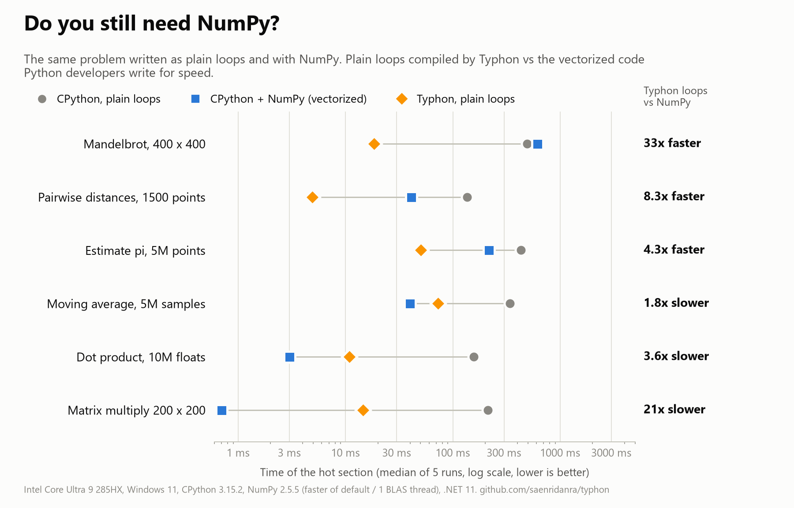

# Typhon vs CPython: benchmark report

This report explains what was measured, how, and what the numbers mean. Raw tables: [`RESULTS.md`](RESULTS.md)
(regenerated by [`run.ps1`](run.ps1)); charts: [`make_charts.py`](make_charts.py).


## TL;DR

* **Typed, pure-Python code runs 2–80x faster on Typhon (geometric mean 10.3x over 9 programs).** The biggest wins
  are numeric loops with floats and small objects (N-body 80x, spectral norm 46x, Mandelbrot 29x); the smallest are
  string/dict/sort workloads where CPython's C-implemented `str`, `dict` and Timsort already do the heavy lifting
  (2.0–2.4x).
* **Type hints are what make it fast.** The same N-body source without annotations falls back to .NET `dynamic` and
  is only 1.8x faster than CPython instead of 80x: a 46x gap caused by the annotations alone.
* **NumPy code is at rough parity (geometric mean 1.18x).** Typhon.NumPy wins where Python-level overhead matters
  (element loops 3.5x, broadcasting 3.1x) and loses clearly on dense linear algebra, where NumPy calls LAPACK
  (solve + inverse: NumPy 10x faster).
* **You often don't need NumPy on Typhon.** For half of the problems tested, plain Python loops compiled by Typhon
  beat the vectorized NumPy code a Python developer would write for speed: Mandelbrot 33x, pairwise distances
  8.3x, Monte-Carlo-style π 4.3x. NumPy keeps the lead where it calls a tuned C/BLAS kernel (dot product, matrix
  multiply, cumulative sums).
* **Memory is mixed.** Typhon has a ~7 MB higher floor (the .NET runtime) and a garbage collector that trades memory
  for speed, so small or allocation-heavy programs use more RAM (20–43 MB vs 12–22 MB). Typed data is much denser,
  so programs that hold large lists use *less* RAM (dot product 174 vs 468 MB, moving average 137 vs 395 MB).
  Large NumPy temporaries are Typhon's weak spot (up to 5x NumPy's peak).

## Setup

| | |
|---|---|
| Machine | Intel Core Ultra 9 285HX (24 cores: 8 performance + 16 efficiency), 64 GB RAM (laptop), Windows 11 Pro |
| CPython | 3.15.2, standard build (experimental JIT not enabled) |
| NumPy | 2.5.5 with OpenBLAS 0.3.34 (`scipy-openblas`, the official wheel) |
| Typhon | this repository; .NET SDK 11.0.100; programs compiled with `typhon build --strict` and run with `dotnet app.dll` (JIT, default GC settings) |
| Typhon.NumPy | this repository; C# on `System.Numerics.Tensors.TensorPrimitives` (SIMD) |

## Method

* **Identical source.** Every benchmark is one `.ty` file that is valid Python and valid Typhon. CPython runs it
  directly (`python file.ty`); Typhon compiles it once and runs the resulting assembly.
* **Correctness check.** Every program prints a result. The runner compares CPython's and Typhon's output, and for
  the problems all four variants (CPython/Typhon × loops/NumPy). **Every result matched.**
* **Timing.** Each program measures its own hot section with `time.perf_counter()` (data setup and Typhon's
  compile step are excluded). Every configuration ran 5 times; the median is reported.
* **End-to-end time** of the whole process is reported too. Startup is not a disadvantage for Typhon here: a
  compiled Typhon program finishes faster end-to-end than CPython on every pure-Python benchmark. Compiling a
  program with `typhon build` takes a median of 1.8 s; `typhon run` (compile + run, like `python file.py`) pays that
  every time.
* **RAM** is the peak working set of the process, read with `GetProcessMemoryInfo`. CPython is measured on the base
  interpreter (a Windows venv's `python.exe` is a launcher that spawns a child, which would hide the real number).
* **Threads.** Threading decides some NumPy results, so NumPy programs ran in two configurations on each side:
  NumPy with default OpenBLAS threads and with `OPENBLAS_NUM_THREADS=1`; Typhon.NumPy with default threads and with
  `TYPHON_NUMPY_THREADS=1`. Comparisons use each side's **faster** configuration. This matters: with default
  threads, OpenBLAS was 37x slower on the 300 x 300 linear-algebra benchmark (1,269 ms vs 34.6 ms with one thread),
  a known over-subscription problem on hybrid P-/E-core CPUs. Reporting NumPy's default would have shown a false
  ~3x Typhon win.

## 1. Pure Python programs

| Program | What it stresses | CPython | Typhon | Speed-up | RAM CPython | RAM Typhon |
|---|---|---|---|---|---|---|
| N-body | float math on object attributes | 3,948 ms | 49.2 ms | **80x** | 12 MB | 21 MB |
| Spectral norm | nested loops, small function calls | 498 ms | 10.9 ms | **46x** | 12 MB | 21 MB |
| Mandelbrot | tight float loop | 1,852 ms | 63.4 ms | **29x** | 12 MB | 20 MB |
| Binary trees | millions of small objects (GC) | 886 ms | 91.9 ms | **9.6x** | 22 MB | 43 MB |
| fib(32) | recursive calls | 145 ms | 15.8 ms | **9.2x** | 12 MB | 20 MB |
| Fannkuch | int lists, swaps, slicing | 318 ms | 44.1 ms | **7.2x** | 12 MB | 40 MB |
| Prime sieve | list indexing, `sum` over a generator | 1,450 ms | 365 ms | **4.0x** | 50 MB | 37 MB |
| `sorted()` | Timsort (C in CPython) on 1M ints + 300k strings | 530 ms | 220 ms | **2.4x** | 88 MB | 61 MB |
| Word count | string building + dict updates | 365 ms | 179 ms | **2.0x** | 12 MB | 41 MB |
| N-body, untyped | the N-body source without type hints (`dynamic`) | 4,154 ms | 2,283 ms | **1.8x** | 12 MB | 59 MB |

**Why the spread.** Typhon turns annotated Python into statically typed IL: a `float` attribute is an unboxed `double`
field, `a.x * b.x` is one machine instruction, and a call is a direct call the JIT can inline. CPython executes the
same code as bytecode on boxed objects. The gap is largest where the program is pure arithmetic on simple types and
smallest where the work happens inside CPython's C runtime anyway (hashing and comparing strings, sorting).

**Gradual typing has a real cost.** `nbody_untyped` is the same file with the annotations removed. Typhon still
compiles it (in `permissive` mode), but every operation becomes a late-bound `dynamic` call, and it is 46x slower
than the typed version. In `strict` mode the compiler rejects it, which is the point of that mode.

## 2. NumPy programs

| Program | NumPy (best config) | Typhon.NumPy (best config) | Speed-up | RAM NumPy | RAM Typhon |
|---|---|---|---|---|---|
| Element loop `for i in range(n): a[i]` | 306 ms | 87.5 ms | **3.5x** | 43 MB | 61 MB |
| Broadcasting (pairwise distances, 2000²) | 400 ms | 131 ms | **3.1x** | 211 MB | 516 MB |
| Reductions along axes (2000 x 2000) | 845 ms | 526 ms | **1.6x** | 89 MB | 91 MB |
| ufuncs (`sqrt`, `exp`, `sin`, 1M x 50) | 1,843 ms | 1,412 ms | **1.3x** | 74 MB | 362 MB |
| Matmul 1000 x 1000 (twice) | 39.8 ms | 32.0 ms | **1.2x** | 64 MB | 87 MB |
| `linalg.solve` + `inv` 300 x 300 | 34.6 ms | 355 ms | **NumPy 10x faster** | 37 MB | 35 MB |

**Important:** NumPy itself is not compiled by Typhon. NumPy's core is C and Fortran, so a Python-syntax compiler
has nothing to compile there. What runs on Typhon is the *user's numpy program*, against Typhon.NumPy, a
numpy-compatible library written in C# for this project.

* Typhon.NumPy wins where NumPy pays per-call Python overhead: the element loop (each `a[i]` on CPython boxes a
  `numpy.float64`) and broadcasting.
* Element-wise ufuncs are close (1.3x): both sides run SIMD loops; Typhon.NumPy also uses multiple threads for
  large arrays, NumPy's ufuncs run on one thread. Single-threaded, Typhon.NumPy is 1.3x faster on ufuncs as well
  (see `RESULTS.md`, "Typhon 1 thread").
* Matrix multiply is at parity: OpenBLAS vs Typhon.NumPy's own AVX2 kernel, both multi-threaded.
* Linear algebra is NumPy's clear win: LAPACK's blocked LU decomposition versus a straightforward implementation
  in Typhon.NumPy.

## 3. Problems: plain loops vs NumPy, on both runtimes



The same problem written twice, as plain Python loops and as vectorized NumPy code, each run on both runtimes.
This answers the practical question: on CPython you vectorize because loops are slow; is that still necessary on
Typhon?

| Problem | CPython loops | CPython + NumPy | Typhon loops | Typhon + NumPy | Typhon loops vs CPython + NumPy |
|---|---|---|---|---|---|
| Mandelbrot 400 x 400, 100 iterations | 493 ms | 612 ms | **18.5 ms** | 514 ms | **33x faster** |
| Pairwise distances, 1500 points | 136 ms | 40.9 ms | **4.9 ms** | 48.3 ms | **8.3x faster** |
| Estimate π, 5M points | 432 ms | 217 ms | **50.1 ms** | 101 ms | **4.3x faster** |
| Moving average, 5M samples | 341 ms | **39.6 ms** | 72.6 ms | 111 ms | 1.8x slower |
| Dot product, 10M floats | 157 ms | **3.0 ms** | 10.9 ms | 8.3 ms | 3.6x slower |
| Matrix multiply 200 x 200 | 212 ms | **0.7 ms** | 14.6 ms | 6.5 ms | 21x slower |

* **Typhon's plain loops are 4.7–28x faster than CPython's plain loops** (geometric mean 13.6x).
* **Against vectorized NumPy, plain Typhon loops win 3 of 6 problems** (geometric mean 1.43x across all six). They
  win where vectorization forces extra work: the vectorized Mandelbrot must iterate every point 100 times because
  arrays can't exit early per element (it is even slower than CPython's own loops), and pairwise distances and π
  materialize large temporary arrays that a loop never needs.
* **NumPy wins where it hands the whole problem to one tuned kernel**: BLAS for dot product and matrix multiply,
  a single C pass for `cumsum`. A naive triple loop does not beat BLAS, on any runtime.
* Taking the best implementation on each runtime, Typhon is ahead by a geometric mean of 1.65x.

### Memory for the problems

| Problem | CPython loops | CPython + NumPy | Typhon loops | Typhon + NumPy |
|---|---|---|---|---|
| Dot product | 468 MB | 180 MB | 174 MB | 185 MB |
| Moving average | 395 MB | 142 MB | 137 MB | 301 MB |
| π estimate | 12 MB | 257 MB | 21 MB | 370 MB |
| Pairwise distances | 12 MB | 114 MB | 21 MB | 130 MB |
| Mandelbrot | 12 MB | 42 MB | 20 MB | 111 MB |
| Matrix multiply | 15 MB | 30 MB | 23 MB | 27 MB |

A Python `list[float]` stores a pointer to a separately allocated float object per element (8 + 24 bytes); Typhon's
`list[float]` is a `List<double>` (8 bytes). That is why plain loops over big lists need 2.7–2.9x less memory on Typhon
than on CPython, and as little as the NumPy version.

## 4. Why Typhon sometimes uses more RAM

Both columns measure the same thing (peak working set of the whole process), so they are comparable as "what the OS
charges the process". They are not comparable as "how much data the program holds", because the runtimes manage
memory differently:

| Cause | Evidence | Effect on Typhon |
|---|---|---|
| **Runtime floor**: .NET runtime, JIT and framework libraries | `print(1)`: CPython 11.6 MB, Typhon 19.0 MB | about +7 MB for every program |
| **Garbage collection vs reference counting**: CPython frees an object as soon as its last reference disappears; .NET collects garbage in batches, sized by the "gen0 budget" | with a 4 MB gen0 budget, Fannkuch and word count drop from 40–41 MB to 27 MB at the same speed | +13–20 MB in allocation-heavy programs |
| **Large NumPy temporaries**: `np.sqrt(x) * 2.0 - x / 3.0` creates several large intermediate arrays; NumPy frees each immediately, .NET only reclaims them in a full collection | `System.GC.ConserveMemory=5` halves the ufuncs peak (362 → 181 MB, and runs 12% faster) | up to 5x NumPy's peak |
| **Dynamic typing**: untyped code loads the C# runtime binder and generates code per call site | `nbody_untyped` 59 MB vs typed `nbody` 21 MB | +38 MB |

GC configuration experiment (compiled Typhon programs, median of 3 runs):

| Program | .NET defaults | `ConserveMemory=5` | gen0 budget 4 MB |
|---|---|---|---|
| Fannkuch | 42 ms, 40 MB | 41 ms, 41 MB | 35 ms, **27 MB** |
| Word count | 175 ms, 41 MB | 177 ms, 41 MB | 156 ms, **27 MB** |
| Binary trees | 82 ms, 43 MB | 80 ms, 43 MB | 79 ms, **37 MB** |
| NumPy ufuncs | 1,404 ms, 362 MB | 1,237 ms, **181 MB** | 1,426 ms, 362 MB |
| NumPy broadcasting | 144 ms, 516 MB | 143 ms, **424 MB** | 141 ms, 515 MB |
| π with NumPy | 104 ms, 370 MB | 91 ms, 370 MB | 103 ms, 370 MB |

The published numbers use .NET defaults: no GC tuning. (They were measured with `System.GC.RetainVM=true`; the
control run above shows identical peak RAM and timings within noise without it, and the setting has since been
removed.) The structural fix for NumPy temporaries is in the compiler, not the GC: Typhon knows that the
intermediate results of `np.sqrt(x) * 2.0 - x / 3.0` are dead after the expression and could reuse their buffers or
fuse the expression into one loop.

## Limitations

* One machine, one OS, a laptop CPU with performance and efficiency cores. Runs varied by roughly ±10–30 %.
* A small benchmark set, written for this proof of concept, with type annotations (Typhon needs them; CPython
  ignores them). Real applications spend time in I/O, libraries and startup that these programs don't model.
* The comparison is against standard CPython only. PyPy, Cython, mypyc, Numba and CPython's experimental JIT
  would all narrow the gap on the pure-Python programs and were not measured.
* Typhon.NumPy implements a subset of NumPy (float64 only) and does not match NumPy's random-number streams.
* Typhon and Typhon.NumPy were vibe-coded in a short time (see the README); results show what the approach can do,
  not a finished product.

## Reproduce

```powershell
python -m venv .venv; .venv\Scripts\pip install numpy matplotlib
./benchmarks/run.ps1 -Repeat 5              # writes benchmarks/RESULTS.md
.venv\Scripts\python benchmarks/make_charts.py   # writes benchmarks/img/*.png
```
