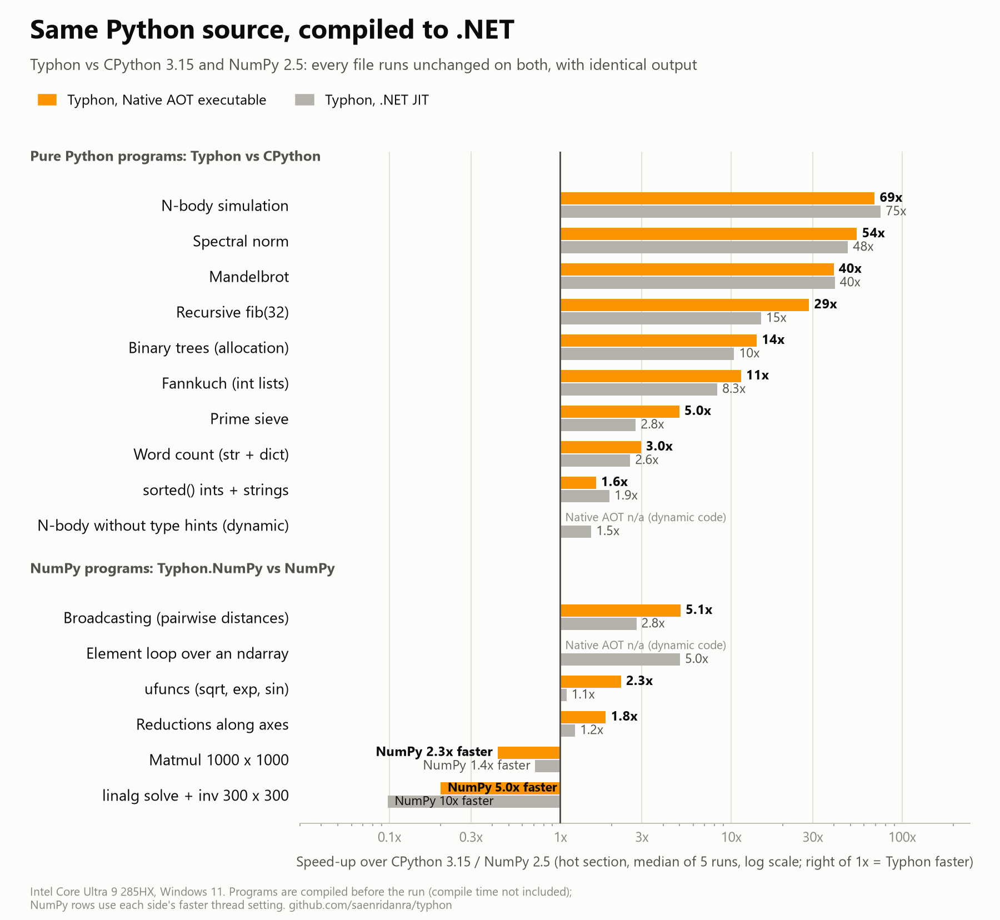
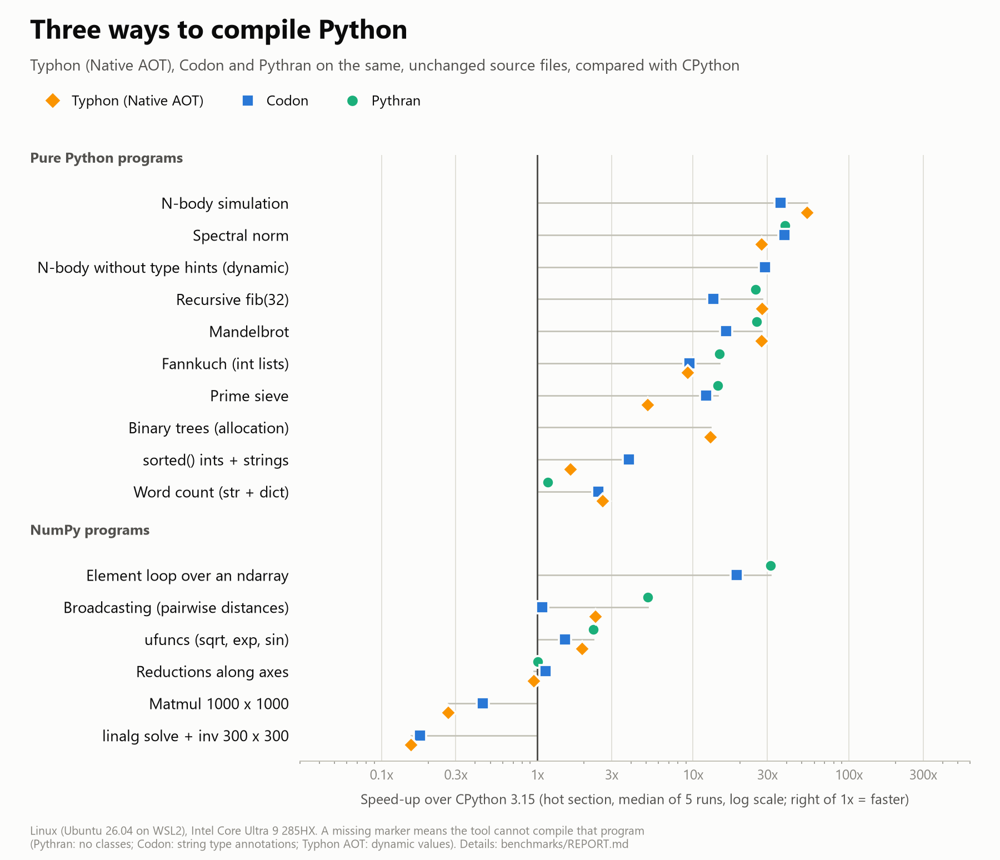

# Typhon benchmark report

What was measured, how, and what the numbers mean. Raw tables: [`RESULTS.md`](RESULTS.md) (Windows, from
[`run.ps1`](run.ps1)) and [`RESULTS_LINUX.md`](RESULTS_LINUX.md) (Linux, from [`linux/run_linux.sh`](linux/run_linux.sh));
charts: [`make_charts.py`](make_charts.py).



## TL;DR

* **Typed, pure-Python code runs 1.9–75x faster on Typhon than on CPython** (geometric mean over 9 programs: **11.1x
  with the JIT, 13.6x as a Native AOT executable**). Biggest wins: numeric loops over floats and small objects
  (N-body 75x, spectral norm 48x, Mandelbrot 40x). Smallest: string, dict and sort workloads, where CPython's C
  runtime already does the heavy lifting (1.6–3.0x).
* **Type hints are what make it fast.** The N-body source without annotations falls back to .NET `dynamic` and is only
  1.5x faster than CPython, 54x slower than the typed version.
* **Native AOT makes Typhon programs small and lean**: a self-contained 1.5–1.9 MB executable, **9 MB of RAM** for small
  programs (CPython 12 MB, Typhon JIT 20 MB) and startup on par with CPython on Windows (21 vs 20 ms); on Linux
  **1.8 ms and 4 MB**, the fastest and smallest of every tool tested.
* **Compared with other Python compilers on Linux** (same files, same CPython baseline), Typhon AOT is in the same
  league as Codon and Pythran: geometric mean over the 6 programs all four can compile **Typhon AOT 11.8x, Codon
  11.6x, Pythran 13.6x**. Typhon leads on float- and object-heavy code (N-body, Mandelbrot, fib), Codon and Pythran on
  integer/list code (prime sieve, π). Only **Codon** stays fast on code **without type hints** (29x), because it infers
  types for the whole program.
* **NumPy code is at rough parity** with real NumPy (geometric mean 1.04x with the JIT, 1.13x with Native AOT). Typhon
  wins element loops and broadcasting, NumPy wins dense linear algebra (LAPACK) by 5x (Native AOT) to 10x (JIT).
* **You often don't need NumPy on Typhon**: plain loops compiled by Typhon beat the vectorized NumPy code on 3 of 6
  problems (Mandelbrot 29x, pairwise distances 7.8x, π 3.6x).
* **Memory is mixed.** With the JIT, Typhon has a ~8 MB higher floor and a garbage collector that trades memory for
  speed. Native AOT removes the floor. Typed lists are much denser than Python lists (dot product: 175 vs 468 MB), but
  large NumPy temporaries are Typhon's weak spot (up to 5x NumPy's peak).

## Setup

| | Windows | Linux |
|---|---|---|
| Machine | Intel Core Ultra 9 285HX (24 cores: 8 performance + 16 efficiency), 64 GB RAM, laptop | same machine, Ubuntu 26.04 on WSL2 (kernel 6.18), 12 GB / 24 vCPUs visible |
| CPython | 3.15.2 (standard build, experimental JIT off) | 3.15.2 (via uv) |
| NumPy | 2.5.5 + OpenBLAS 0.3.34 (official wheel) | same |
| Typhon | .NET SDK 11.0.100; `typhon build --strict`, run with `dotnet app.dll` (JIT) or as a Native AOT `.exe` | same, AOT linked with clang 21 |
| Others | – | **Codon 0.20.7** (`codon build -release`, host CPU, own NumPy + OpenBLAS 0.3.33); **Pythran 0.19.0** (`-O3 -march=native`, clang++ 21) |

## Method

* **Identical source.** Every benchmark is one `.ty` file that is valid Python, valid Typhon, and (where the tool
  supports the features) valid Codon and Pythran. The only additions for Pythran are `#pythran export` comments.
* **Correctness check.** Every program prints a result; the runners compare every tool's output with CPython's.
  **Every result matched, on both operating systems, for every tool.**
* **Timing.** Each program measures its own hot section with `time.perf_counter()`; data setup and every compile step
  are excluded. Every configuration ran 5 times; the median is reported. End-to-end process time is reported as well.
* **Compile times** (median per program, not in the timings): Typhon 1.3 s, Typhon Native AOT 4.8 s (Windows) /
  3.8 s (Linux), Codon 4.3 s, Pythran 1.6 s.
* **RAM** is the peak working set (Windows) or max resident set size (Linux) of the whole process.
* **Threads.** NumPy-style programs run in two configurations per tool where possible: NumPy with default OpenBLAS
  threads and with `OPENBLAS_NUM_THREADS=1`; Typhon.NumPy with default threads and `TYPHON_NUMPY_THREADS=1`.
  Comparisons use each side's **faster** configuration. This matters: with default threads, OpenBLAS is 32x slower on
  the 300 x 300 linear-algebra benchmark (1,024 ms vs 31.7 ms single-threaded), a known over-subscription problem on
  hybrid P-/E-core CPUs. Reporting NumPy's default would have shown a false Typhon win.
* **Two measurement traps we hit (and avoided in the final numbers):**
  * On this Windows machine, an executable launched from `%TEMP%` started 3x slower and used 3x the RAM of the very same
    file launched from the repository (a plain C# Native AOT "hello": 62 ms / 25 MB vs 19 ms / 8.5 MB), presumably
    security software inspecting new executables in the temp folder. All benchmark executables run from the repository.
  * In the WSL distro used here, the systemd user session fails to start, and WSL shuts the distro down ~2 minutes after
    every start. The Linux numbers were measured with systemd temporarily disabled in that distro (restored afterwards).

## 1. Pure Python programs (Windows)

| Program | What it stresses | CPython | Typhon JIT | Typhon AOT | Speed-up JIT | Speed-up AOT |
|---|---|---|---|---|---|---|
| N-body | float math on object attributes | 3,024 ms | 40.3 ms | 43.8 ms | **75x** | **69x** |
| Spectral norm | nested loops, small function calls | 469 ms | 9.7 ms | 8.6 ms | **48x** | **54x** |
| Mandelbrot | tight float loop | 2,067 ms | 51.1 ms | 51.9 ms | **40x** | **40x** |
| fib(32) | recursive calls | 134 ms | 9.0 ms | 4.7 ms | **15x** | **29x** |
| Binary trees | millions of small objects (GC) | 783 ms | 75.3 ms | 55.5 ms | **10x** | **14x** |
| Fannkuch | int lists, swaps, slicing | 324 ms | 39.1 ms | 28.4 ms | **8.3x** | **11x** |
| Prime sieve | list indexing, `sum` over a generator | 989 ms | 358 ms | 199 ms | **2.8x** | **5.0x** |
| Word count | string building + dict updates | 413 ms | 161 ms | 140 ms | **2.6x** | **3.0x** |
| `sorted()` | Timsort (C in CPython) on 1M ints + 300k strings | 353 ms | 182 ms | 218 ms | **1.9x** | **1.6x** |
| N-body, untyped | the N-body source without type hints (`dynamic`) | 3,286 ms | 2,168 ms | n/a | **1.5x** | – |

**Why the spread.** Typhon turns annotated Python into statically typed code: a `float` attribute is an unboxed
`double` field, `a.x * b.x` is one machine instruction, and a call is a direct call. CPython executes bytecode on boxed
objects. The gap is largest for pure arithmetic on simple types and smallest where the work happens inside CPython's C
runtime anyway (hashing and comparing strings, sorting).

**JIT vs Native AOT.** Ahead-of-time compilation is faster on most programs (no warm-up, no tiered compilation) and
slower on two (N-body, sort), where the JIT's runtime profile-guided optimization helps. AOT targets a portable CPU
baseline by default, while the JIT optimizes for the exact CPU.

**Gradual typing has a real cost.** `nbody_untyped` compiles in `permissive` mode, but every operation becomes a
late-bound `dynamic` call. `strict` mode rejects it, and Native AOT can't compile it at all (late binding generates
code at run time).

## 2. Startup and footprint

| | Process time Windows | RAM Windows | Process time Linux | RAM Linux | What you ship |
|---|---|---|---|---|---|
| CPython | 19.7 ms | 12 MB | 9.2 ms | 12 MB | the `.py` file + a Python installation |
| Codon | – | – | 8.3 ms | 10 MB | small executable + Codon runtime libraries |
| Typhon JIT | 34.5 ms | 20 MB | 20.0 ms | 30 MB | 0.05 MB `.dll` + the .NET runtime |
| **Typhon Native AOT** | **21.3 ms** | **9 MB** | **1.8 ms** | **4 MB** | **one 1.5–1.9 MB self-contained executable** |

`bench_startup.ty` is a tiny program (split, uppercase, join). End-to-end, a compiled Typhon program is faster than
CPython on every pure-Python benchmark, with the JIT as well as with AOT (e.g. fib: CPython 158 ms, JIT 46 ms, AOT
24 ms on Windows).

## 3. NumPy programs (Windows)

| Program | NumPy (best config) | Typhon JIT (best config) | Typhon AOT | Speed-up (best Typhon build) | RAM NumPy | RAM JIT | RAM AOT |
|---|---|---|---|---|---|---|---|
| Element loop `for i in range(n): a[i]` | 271 ms | 54.0 ms | n/a | **5.0x** | 43 MB | 61 MB | – |
| Broadcasting (pairwise distances, 2000²) | 268 ms | 95.9 ms | 52.9 ms | **5.1x** | 211 MB | 516 MB | 578 MB |
| Reductions along axes (2000 x 2000) | 414 ms | 340 ms | 224 ms | **1.8x** | 89 MB | 91 MB | 72 MB |
| ufuncs (`sqrt`, `exp`, `sin`, 1M x 50) | 1,184 ms | 1,089 ms | 522 ms | **2.3x** | 74 MB | 362 MB | 225 MB |
| Matmul 1000 x 1000 (twice) | 17.4 ms | 24.4 ms | 40.3 ms | **NumPy 1.4x faster** | 64 MB | 89 MB | 56 MB |
| `linalg.solve` + `inv` 300 x 300 | 31.7 ms | 325 ms | 159 ms | **NumPy 5.0x faster** | 37 MB | 37 MB | 16 MB |

**Important:** NumPy itself is not compiled by Typhon; its core is C and Fortran. What runs on Typhon is the *user's
numpy program*, against Typhon.NumPy, a numpy-compatible library written in C# for this project (float64 only).

* Typhon.NumPy wins where NumPy pays per-call Python overhead: the element loop (each `a[i]` on CPython creates a boxed
  `numpy.float64`) and broadcasting.
* Native AOT roughly halves the time of ufuncs, reductions and linear algebra compared with the JIT here.
* NumPy keeps the lead where it calls tuned native libraries: OpenBLAS for matrix multiply, LAPACK for `solve`/`inv`.
  Typhon's AOT matmul is slower than its JIT one, presumably because Native AOT targets a portable instruction set by
  default, so the AVX2/FMA kernel path is not taken (not verified).
* Three NumPy programs can't be compiled with Native AOT (`a[i]`, `np.dot` and slicing return `dynamic` in
  Typhon.NumPy). `typhon build --aot` reports the exact lines (TY2001).

## 4. Problems: plain loops vs NumPy


The same problem written twice, as plain Python loops and as vectorized NumPy code, each run on both runtimes
(Windows). On CPython you vectorize because loops are slow. Is that still necessary on Typhon?

| Problem | CPython loops | CPython + NumPy | Typhon loops (JIT) | Typhon loops (AOT) | Typhon + NumPy (JIT) | Typhon + NumPy (AOT) |
|---|---|---|---|---|---|---|
| Mandelbrot 400 x 400, 100 iterations | 496 ms | 415 ms | 14.2 ms | **11.4 ms** | 340 ms | 234 ms |
| Pairwise distances, 1500 points | 148 ms | 30.3 ms | 3.9 ms | **3.3 ms** | 38.7 ms | 8.1 ms |
| Estimate π, 5M points | 388 ms | 160 ms | 45.0 ms | 43.5 ms | 69.6 ms | **32.9 ms** |
| Moving average, 5M samples | 329 ms | **31.3 ms** | 56.0 ms | 56.3 ms | 82.5 ms | n/a |
| Dot product, 10M floats | 152 ms | **1.4 ms** | 6.8 ms | 6.5 ms | 7.2 ms | n/a |
| Matrix multiply 200 x 200 | 206 ms | **0.4 ms** | 12.3 ms | 7.4 ms | 5.3 ms | 0.7 ms |

* **Typhon's plain loops are 6–38x faster than CPython's plain loops** (geometric mean 17x).
* **Against vectorized NumPy, plain Typhon loops win 3 of 6 problems**: where vectorization forces extra work
  (Mandelbrot must iterate every point 100 times because arrays can't exit early per element) or builds large
  temporary arrays (pairwise distances, π).
* **NumPy wins where one tuned kernel does the whole job**: BLAS for dot product and matrix multiply, a single C pass
  for `cumsum`. A naive triple loop doesn't beat BLAS on any runtime. (Typhon.NumPy with AOT gets the 200 x 200
  matmul to 0.7 ms, close to NumPy's 0.4 ms; with the JIT, warm-up dominates such a short call.)

Peak RAM for the problems (Windows):

| Problem | CPython loops | CPython + NumPy | Typhon loops (JIT) | Typhon loops (AOT) | Typhon + NumPy (JIT) | Typhon + NumPy (AOT) |
|---|---|---|---|---|---|---|
| Dot product | 468 MB | 180 MB | 175 MB | 182 MB | 185 MB | n/a |
| Moving average | 395 MB | 142 MB | 137 MB | 118 MB | 301 MB | n/a |
| π estimate | 12 MB | 257 MB | 21 MB | 9 MB | 370 MB | 353 MB |
| Pairwise distances | 12 MB | 114 MB | 21 MB | 9 MB | 130 MB | 113 MB |
| Mandelbrot | 12 MB | 42 MB | 20 MB | 9 MB | 111 MB | 67 MB |
| Matrix multiply | 15 MB | 30 MB | 23 MB | 11 MB | 27 MB | 11 MB |

A Python `list[float]` stores a pointer to a separately allocated float object per element (8 + 24 bytes); Typhon's
`list[float]` is a `List<double>` (8 bytes). That's why plain loops over big lists need 2.7–2.9x less memory on Typhon.

## 5. Typhon vs Codon vs Pythran (Linux)



[Codon](https://github.com/exaloop/codon) compiles whole Python-syntax programs to native code via LLVM, with
whole-program type inference. [Pythran](https://github.com/serge-sans-paille/pythran) compiles exported numeric
functions to C++ extension modules for CPython. Both run on Linux only here, so this comparison runs on Linux (WSL2,
same machine) against CPython on Linux. Speed-ups are relative to CPython on Linux.

| Program | CPython | Codon | Pythran | Typhon JIT | Typhon AOT |
|---|---|---|---|---|---|
| N-body | 2,439 ms | 66.6 ms (37x) | n/a: classes | **39.3 ms (62x)** | 45.2 ms (54x) |
| Spectral norm | 381 ms | 9.9 ms (39x) | 9.8 ms (39x) | **9.3 ms (41x)** | 13.8 ms (28x) |
| Mandelbrot | 1,348 ms | 82.6 ms (16x) | 52.7 ms (26x) | **48.7 ms (28x)** | **48.7 ms (28x)** |
| fib(32) | 108 ms | 8.0 ms (14x) | 4.3 ms (25x) | 7.5 ms (14x) | **3.9 ms (28x)** |
| Binary trees | 626 ms | n/a: `Optional["Node"]` | n/a: classes | 76.6 ms (8.2x) | **48.1 ms (13x)** |
| Fannkuch | 261 ms | 27.5 ms (9.5x) | **17.7 ms (15x)** | 39.5 ms (6.6x) | 28.1 ms (9.3x) |
| Prime sieve | 979 ms | 80.5 ms (12x) | **67.6 ms (15x)** | 347 ms (2.8x) | 191 ms (5.1x) |
| `sorted()` | 359 ms | **92.5 ms (3.9x)** | n/a: not in a function | 176 ms (2.0x) | 220 ms (1.6x) |
| Word count | 351 ms | 143 ms (2.5x) | 302 ms (1.2x) | 182 ms (1.9x) | **133 ms (2.6x)** |
| N-body, untyped | 2,465 ms | **85.2 ms (29x)** | n/a: classes | 2,340 ms (1.1x) | n/a: dynamic |

On the 6 programs every tool can compile, the geometric means are **Pythran 13.6x, Typhon AOT 11.8x, Codon 11.6x,
Typhon JIT 9.2x**.

* **Float- and object-heavy code** (N-body, Mandelbrot, spectral norm, fib): Typhon is at or near the top.
* **Integer and list code** (prime sieve, Fannkuch, and the π problem): Codon and Pythran are clearly faster. Not
  profiled yet; likely contributors are `sum(...)` over a generator expression being lowered to LINQ (prime sieve),
  Python-exact floored modulo through a helper (π), and bounds-checked `List<T>` access, while Codon defaults to C
  semantics. This is the clearest optimization lead for Typhon.
* **Untyped code**: only Codon is fast, because it infers types for the whole program. Typhon falls back to `dynamic`.
  Better type inference is the most valuable improvement for Typhon (see roadmap).
* **Coverage**: Pythran compiles only functions without classes (4 programs n/a), Codon rejected one program (a string
  forward reference in a type annotation), Typhon AOT rejects code that uses `dynamic`.

NumPy programs on Linux (speed-up vs the faster CPython + NumPy configuration):

| Program | CPython + NumPy | Codon | Pythran | Typhon JIT | Typhon AOT |
|---|---|---|---|---|---|
| Element loop | 270 ms | 14.1 ms (19x) | **8.6 ms (31x)** | 61.5 ms (4.4x) | n/a: dynamic |
| Broadcasting | 143 ms | 133 ms (1.1x) | **28.0 ms (5.1x)** | 102 ms (1.4x) | 60.8 ms (2.4x) |
| ufuncs | 660 ms | 437 ms (1.5x) | **287 ms (2.3x)** | 870 ms (0.8x) | 340 ms (1.9x) |
| Reductions | 242 ms | **214 ms (1.1x)** | 241 ms (1.0x) | 346 ms (0.7x) | 255 ms (1.0x) |
| Matmul 1000 x 1000 | **11.8 ms** | 26.3 ms (0.4x) | n/a: not in a function | 20.5 ms (0.6x) | 43.9 ms (0.3x) |
| linalg solve + inv | **24.2 ms** | 137 ms (0.2x) | n/a: `np.linalg` | 519 ms (0.05x) | 156 ms (0.2x) |

Pythran's C++ expression templates are the strongest for NumPy-style code. For dense linear algebra, NumPy's
OpenBLAS/LAPACK beats every compiler.

Comparability notes (from the Linux runner): Pythran converts Python lists to C++ containers at every call (included in
its time; e.g. the 10M-element dot product) and every Pythran module imports NumPy (+~60 ms and +~17 MB per process);
Codon uses 64-bit integers and C numerics by default (no overflow happens in these programs); Codon and Pythran target
the host CPU (`-march=native`), Typhon AOT a portable baseline.

## 6. Why Typhon sometimes uses more RAM

Both runtimes are measured the same way (peak memory of the whole process), so the numbers are comparable as "what the
OS charges the process", not as "how much data the program holds":

| Cause | Evidence | Effect on Typhon |
|---|---|---|
| **.NET runtime floor (JIT only)**: runtime, JIT and framework libraries | tiny program: CPython 12 MB, Typhon JIT 20 MB, **Typhon AOT 9 MB** | about +8 MB with the JIT, none with Native AOT |
| **Garbage collection vs reference counting**: CPython frees an object as soon as its last reference disappears; .NET collects garbage in batches, sized by the "gen0 budget" | with a 4 MB gen0 budget, Fannkuch and word count drop from 40–41 MB to 27 MB at the same speed | +13–20 MB in allocation-heavy programs |
| **Large NumPy temporaries**: `np.sqrt(x) * 2.0 - x / 3.0` creates several large intermediate arrays; NumPy frees each immediately, .NET only reclaims them in a full collection | `System.GC.ConserveMemory=5` halves the ufuncs peak (362 → 181 MB, and runs 12% faster) | up to 5x NumPy's peak |
| **Dynamic typing**: untyped code loads the C# runtime binder and generates code per call site | `nbody_untyped` 59 MB vs typed `nbody` 21 MB | +38 MB |

GC configuration experiment (Typhon JIT programs, median of 3 runs):

| Program | .NET defaults | `ConserveMemory=5` | gen0 budget 4 MB |
|---|---|---|---|
| Fannkuch | 42 ms, 40 MB | 41 ms, 41 MB | 35 ms, **27 MB** |
| Word count | 175 ms, 41 MB | 177 ms, 41 MB | 156 ms, **27 MB** |
| Binary trees | 82 ms, 43 MB | 80 ms, 43 MB | 79 ms, **37 MB** |
| NumPy ufuncs | 1,404 ms, 362 MB | 1,237 ms, **181 MB** | 1,426 ms, 362 MB |
| NumPy broadcasting | 144 ms, 516 MB | 143 ms, **424 MB** | 141 ms, 515 MB |
| π with NumPy | 104 ms, 370 MB | 91 ms, 370 MB | 103 ms, 370 MB |

The published numbers use .NET defaults: no GC tuning. The structural fix for NumPy temporaries belongs in the
compiler: Typhon knows that the intermediate results of `np.sqrt(x) * 2.0 - x / 3.0` are dead after the expression and
could reuse their buffers or fuse the expression into one loop.

## Limitations

* One machine (a laptop CPU with performance and efficiency cores); Linux runs in WSL2 on the same machine. Runs vary
  by roughly ±10–30 %; Windows and Linux numbers are not directly comparable with each other (compare within a table).
* A small benchmark set written for this proof of concept, with type annotations (Typhon needs them; CPython ignores
  them). Real applications spend time in I/O, libraries and startup that these programs don't model.
* Not measured: PyPy, Cython, mypyc, Numba, CPython's experimental JIT.
* Typhon.NumPy implements a subset of NumPy (float64 only) and does not match NumPy's random-number streams.
* Typhon and Typhon.NumPy were vibe-coded in a short time (see the README); results show what the approach can do, not
  a finished product.

## Reproduce

```powershell
# Windows: CPython (+ NumPy) vs Typhon JIT + Native AOT (needs the VS "Desktop development with C++" workload for AOT)
python -m venv .venv; .venv\Scripts\pip install numpy matplotlib
./benchmarks/run.ps1 -Repeat 5                    # writes benchmarks/RESULTS.md

# Linux (WSL): CPython, Codon, Pythran, Typhon (setup: see the header of benchmarks/linux/run_linux.sh)
wsl -- bash -lc "cd benchmarks/linux && bash ./run_linux.sh -n 5"   # writes benchmarks/RESULTS_LINUX.md

.venv\Scripts\python benchmarks/make_charts.py    # writes benchmarks/img/*.png
```
